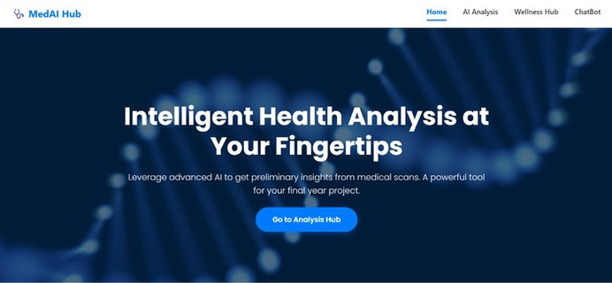
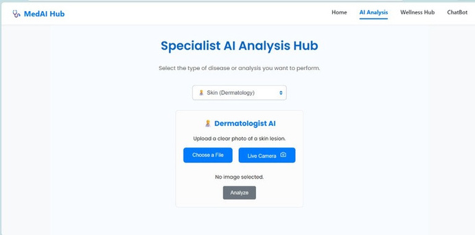
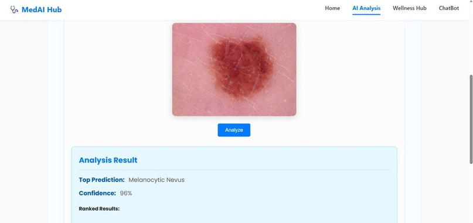
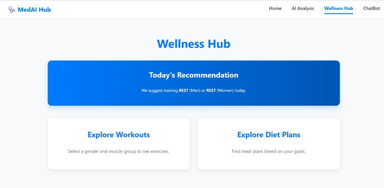

# 🩺 MedAI Hub - Medical Diagnosis System using AI & Machine Learning
*Research Paper:* [Medical Diagnosis System Using Artificial Intelligence and Machine Learning](MEDICAL%20DIAGNOSIS%20SYSTEM%20USING%20ARTIFICIAL%20INTELLIGENCE%20AND%20MACHINE%20LEARNING.pdf)

> Final-year project · Dept. of Computer Science & Engineering · ACS College of Engineering (VTU, Belagavi)
> **Team:** Mohammed Faraz (1AH22CS064) · Mohammed Saifulla (1AH22CS105) · Mohammed Ayaan (1AH23CS409) · Kashinath (1AH22CS070)
> **Guide:** Mr. Charan M S, Asst. Prof., Dept. of CSE

MedAI Hub is a web-based healthcare assistant that applies AI and machine learning to **skin-lesion screening, symptom-based disease prediction, diabetes and heart-disease risk estimation, a conversational health chatbot, and a wellness hub**.

> ⚠️ **Educational project - not a medical device.** It gives preliminary, informational results only and must never replace a doctor. See [Limitations](#-limitations--honesty-note).

## 📸 Screenshots

| Home | AI Analysis Hub |
|---|---|
|  |  |

| AI Prediction | Wellness Hub |
|---|---|
|  |  |

## ✨ Features

| Module | What it does | Technique |
|---|---|---|
| 🔬 **Skin Analysis** | Upload or capture (live camera) a lesion photo → ranked likely conditions, ABCD scores and a lesion-outline overlay | Otsu segmentation + ABCD-rule feature scoring (Pillow, NumPy, SciPy) |
| 🩺 **Symptom Checker** | Tick symptoms → top diseases with likelihood, severity, precautions and which specialist to see | Bernoulli Naive Bayes (scikit-learn), 19 diseases × 41 symptoms |
| 🩸 **Diabetes Risk** | Risk % plus the factors driving it | Explainable Logistic Regression |
| ❤️ **Heart Risk** | Cardiovascular risk % with contributing factors and advice | Explainable Logistic Regression |
| 🤖 **MediBot Chatbot** | Free-text symptoms (understands "no fever"), asks smart follow-ups, predicts disease + confidence, offers doctor info (Y/N), red-flag emergency warnings | NLP keyword/negation matching + Naive Bayes with partial evidence |
| 🥗 **Wellness Hub** | Today's workout recommendation, exercises by muscle group, diet plans by goal, BMI & calorie calculator | Rule-based + Mifflin-St Jeor equation |
| 👤 **Accounts & History** | Register/login, saved analyses, printable report (Save as PDF) | Flask sessions, SQLite, hashed passwords |
| 🌗 **UX** | Responsive layout, dark mode, animated results, accessible forms | Vanilla JS / CSS |
| 🔒 **Security** | CSRF protection, password hashing, upload validation & size limit, XSS-safe rendering, security headers | Flask / Werkzeug |

## 🚀 Quick start

Requires **Python 3.9+**.

```bash
# 1. get the code
git clone https://github.com/<your-username>/medai-hub.git
cd medai-hub

# 2. create a virtual environment
python -m venv venv
# Windows:        venv\Scripts\activate
# macOS / Linux:  source venv/bin/activate

# 3. install dependencies
pip install -r requirements.txt

# 4. run
python app.py
```

Open **http://127.0.0.1:5000**. The ML models train automatically on first start (≈ 2 seconds) and are cached in `models/`.

### Run the tests
```bash
python -m pytest -q tests
```

## 🗂️ Project structure

```
medai-hub/
├── app.py                 # Flask app: routes, APIs, auth, CSRF, SQLite
├── ml/
│   ├── knowledge.py       # diseases, symptoms, precautions, red-flag rules
│   ├── symptom_model.py   # Naive Bayes training + partial-evidence inference
│   ├── risk_models.py     # diabetes & heart logistic-regression models
│   ├── skin.py            # image segmentation + ABCD analysis
│   ├── chatbot.py         # MediBot conversation logic
│   └── wellness.py        # workouts, diets, BMI/calories
├── templates/             # Jinja2 pages
├── static/                # CSS, JS, screenshots
├── tests/test_app.py      # 13 automated tests
├── GITHUB_GUIDE.md        # how to publish this project
└── requirements.txt
```

## 🧠 How the models work

* **Symptom model:** a synthetic dataset (500 patients per disease) is generated from the probabilities in `ml/knowledge.py`, then a Bernoulli Naive Bayes model is trained (80/20 split). At prediction time, symptoms you *don't mention* are treated as **unknown**, and only symptoms you say you *don't have* count as absent - this is what lets the chatbot ask meaningful follow-up questions.
* **Risk models:** logistic regression on a synthetic population whose risk follows known direction-of-effect relationships. Being linear, each prediction is explained by `coefficient × standardised value`.
* **Skin analysis:** the lesion is separated from the skin with Otsu thresholding, then **A**symmetry, **B**order irregularity, **C**olour variation and size are measured and mapped to condition likelihoods.

## ⚠️ Limitations & honesty note

* The disease and risk models are trained on **synthetic data** built from a hand-written knowledge base, so the reported accuracy shows the pipeline works - it is **not clinical validation**.
* The skin module is an **ABCD-rule image heuristic, not a trained deep neural network**.
* Nothing here is a diagnosis. Always consult a qualified doctor.

## 🔮 Upgrading to real data (future work)

1. **Tabular models:** download the *Pima Indians Diabetes* and *UCI Heart Disease* CSVs, load them in `ml/risk_models.py` instead of `generate_*`, retrain with `python -c "from ml import risk_models; risk_models.train_all()"`.
2. **Symptom model:** train on the public *Disease Symptom Prediction* dataset (Kaggle).
3. **Skin CNN:** fine-tune MobileNetV2/ResNet on **HAM10000** and replace `score_classes` in `ml/skin.py` with `model.predict`.
4. Add chest X-ray (pneumonia) detection, multilingual chatbot (Kannada/Hindi), and deploy on Render/Railway.

## 📚 References
See the project synopsis for the literature survey (CNNs for medical imaging, ML disease prediction, NLP in healthcare, telemedicine, precision medicine).

## 📄 License
MIT - see [LICENSE](LICENSE).
